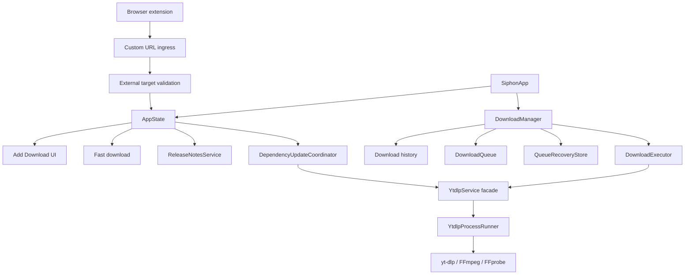

# Siphon Architecture

This document records the runtime ownership boundaries and lifecycle guarantees that are easy to break accidentally in a downloader. It is intentionally narrower than a full code tour.

## Runtime ownership



### Application state

`AppState` owns application-level presentation state and coordination for release notes and dependency updates. Views and app commands observe that state directly.

`DownloadManager` owns download history, queue admission, durable queue recovery, download lifecycle, and the executor. It does not own release-note or dependency-update presentation state.

### Execution ownership

`DownloadExecutor` is the only writer of active task and process-controller ownership. `DownloadManager` exposes read-only execution state and counts rather than task handles.

Stopping or pausing a download requests cancellation. It does not mean the underlying task or process has finished. Executor ownership remains active until `executeDownload` unwinds and its cleanup runs.

The normal cleanup path releases the queue slot, removes task/controller ownership, releases the reserved output path, cleans owned temporary files when appropriate, and notifies the manager that execution finished.

### Durable queue recovery

`QueueRecoveryStore` persists active jobs (`.queued`, `.fetching`, `.downloading`, `.processing`) atomically whenever download state, queue order, or job membership changes.

- Active job metadata (URLs, titles, options, progress, scratch directory paths) is encoded and written atomically to `Application Support/Siphon/queue_recovery.json`. Raw cookies, raw user agents, and arbitrary extra arguments are redacted; the validated non-secret browser-source identifier is retained so protected-site recovery does not silently switch browser profiles.
- Scratch paths are accepted only when they point to Siphon-owned `siphon_scratch_*` directories directly under the process temporary directory. Cleanup refuses any unowned path.
- Paused-job history stores the validated scratch path and non-secret browser-source identifier so pause → quit → reopen → resume can continue partial work against the same browser profile across a clean restart. Raw cookies and raw user agents remain ephemeral.
- Terminal shutdown (`DownloadManager.shutdown()`) records `isCleanShutdown = true`, preventing false-positive recovery prompts across clean application exits.
- If the application process terminates abruptly (crash, SIGKILL, power loss), the uncompleted snapshot remains marked as interrupted. On subsequent launch, `DownloadManager.initialize(...)` detects the interrupted jobs and prompts the user in `ContentView` to restore them back to `.queued` state (preserving per-job scratch directories) or discard them cleanly.

### Recovery and partial-job warnings

Recovered jobs whose advanced arguments were removed are held paused until the user re-enters them or explicitly continues without them. A non-secret review marker survives both recovery and history persistence; argument values remain ephemeral. Recovery write failures appear as a non-blocking warning with a retry action and clear after a successful write. Held restored jobs are committed to history before the interrupted snapshot is replaced.

Partially failed playlists retain their completed output paths but enter Failed with a retry action. Playlist retries skip existing files rather than overwriting completed entries, unless the user explicitly chose overwrite. Partial-failure markers survive history restoration, including migration of older completed-with-error records.

### Dependency update exclusion

yt-dlp replacement is serialized against download execution:

- an update request is rejected while `DownloadManager.activeExecutionCount` is non-zero;
- `DownloadManager.processQueue()` does not admit new work while `YtdlpService.isUpdating` is true;
- queued work is reconsidered when the dependency update finishes.

This prevents a binary replacement from racing with executor-owned work while still allowing downloads submitted during an update to remain queued.

### Terminal shutdown

`DownloadManager.shutdown()` is terminal for that manager instance. It disables future queue admission before requesting executor cancellation and clearing queue reservations.

Executor task/controller ownership is still released by executor teardown rather than being eagerly deleted by the manager. The terminal queue gate is what makes reservation clearing safe during application shutdown.

### External URL ingress

Browser extensions enter through `SiphonApp.handleIncomingURL`. The custom URL is accepted only for supported Siphon schemes and download hosts, then the target URL is validated by `ExternalDownloadTargetPolicy` before it reaches download code. For external deep-link downloads, Siphon enforces `enforcePublicNetworkBoundary`: yt-dlp runs through a local loopback forward proxy (`EgressProxyServer` via `--proxy`) that intercepts connection attempts and HTTP redirects, resolving hostnames and blocking access to loopback, private, link-local, and multicast ranges with HTTP 403. Siphon's internal metadata fetches (e.g. Finder icon thumbnails) re-apply the public network policy on every redirect via `PublicRedirectPolicy`. Custom user arguments cannot override this proxy configuration for boundary-enforced downloads. Site-specific resolvers inherit the boundary through the `EgressBoundary.proxyURL` task-local that `YtdlpService.fetchInfo` and `download` bind: their yt-dlp runs, `URLSession` requests and WebKit sessions go through the same proxy. The proxy forwards one plain-HTTP request per upstream connection (`Connection: close`), because clients reuse a proxy connection across hosts.

Fast-download deep links hand their sanitized browser identifier and user agent straight to the job; only the Add Download sheet path stores deep-link state in `AppState`, and its external-target marker is cleared when the sheet closes, not when credentials are consumed.

Raw cookies are never accepted through the custom URL. Browser source identifiers and user agents are sanitized, and browser-session state is scoped to the validated target origin (scheme, hostname, and effective port). Chrome handoff cleanup stores per-tab deadlines in session storage and uses alarms, so service-worker suspension does not lose pending helper tabs; tabs navigated to another page are retained.

### App update trust

Releases newer than `UpdateChecker.lastUnsignedRelease` must carry `release-manifest.json` and `release-manifest.json.sig`, signed offline with the Ed25519 key whose public half is pinned in `UpdateManifestVerifier`. Create both with `swift scripts/sign-release-manifest.swift sign <key> <version> <assets>` and upload them with the release assets; a release without them is refused rather than verified by checksum alone.

### App update installation

Update installation captures an immutable release candidate before its first asynchronous fetch. Manifest and checksum verification use only that candidate; update checks and repeated installations are excluded while preparation or installation is active.

The installer copies and verifies a complete replacement beside the installed app, then exchanges the two directory names using `renameatx_np(RENAME_SWAP)`. Both replacement and rollback are single filesystem operations. A process interruption leaves a complete old or new app at the installed path and the other complete bundle at the sibling backup path. Unsupported exchanges fail with the original app intact; there is no delete-and-copy fallback. A rollback failure retains the original backup and reports its path. Abrupt interruptions may leave a hidden backup for manual cleanup; this does not promise storage durability after a hardware or filesystem failure.

## Native playback

Playback is owned by `PlaybackWindowManager` and `PlaybackService`, separately
from download execution and history. All existing Play actions route through
`DownloadManager.openFile`: AVFoundation-supported local containers open in the
native player, while other containers keep their default-app behavior. File →
Open Media and Play Stream provide explicit local and clear-HLS entry points.
Open Stream File imports a locally selected, versioned JSON descriptor for clear
or explicitly configured FairPlay HLS.
Playback failure does not change a completed download's status.

`PlaybackService` retains the player/item, status observations, current setup
task, gateway and content-key service. Replacement, cancellation and window
closure detach the item, invalidate observations and cancel owned work. A
generation identifier rejects late callbacks from previous sources.

Remote streams require HTTPS. Since AVURLAsset has no documented per-asset
proxy configuration, `HLSPlaybackGateway` serves rewritten manifests and media
on an ephemeral loopback listener. Only registered, random routes are served.
Every upstream fetch goes through `EgressProxyServer`, including redirects,
preserving connection-time public-address checks. The gateway rewrites variant,
rendition, segment, initialization and clear-key references; only explicitly
configured FairPlay `skd://` identifiers remain intact. Unsupported protection,
content steering, interstitial asset references and unresolved playlist
variables fail closed. Responses are bounded to 64 MiB and four concurrent
gateway connections. This first implementation buffers each segment; very large
segments and low-latency HLS need a separate transport extension.

Local playlists and managed offline packages are rejected: treating either as
an ordinary file would skip source validation and license ownership.

### FairPlay provider integration status

`DRMConfiguration` describes an explicitly trusted provider, including a
certificate endpoint, license endpoint, and a mapping from exact SKD key URIs
to UTF-8 content IDs. The current license adapter supports only raw binary SPC
POST and raw `application/octet-stream` CKC responses. Optional Authorization
is license-only, ephemeral and never persisted or logged; browser cookies and
shared URLSession credentials are disabled. Certificate/license redirects stay
on their configured HTTPS origin. HTTP errors, empty bodies and oversized
responses fail without fabricated keys or automatic authorization retries.

The retained AVContentKeySession is configured before the asset reaches the
player. Its delegate handles new and renewing key requests, generates SPC using
AVContentKeyRequest, obtains CKC, and submits either a response or a terminal
error. Cancellation resolves callback bridges once and discards late SPC
callbacks; closing playback cancels pending licenses and expires the session.
Apple's APIs are documented in
[AVContentKeySession](https://developer.apple.com/documentation/avfoundation/avcontentkeysession)
and [AVContentKeyRequest](https://developer.apple.com/documentation/avfoundation/avcontentkeyrequest).

The Play Stream URL field admits clear HLS only. Open Stream File accepts a
provider-supplied descriptor of at most 64 KiB. Its server destinations appear
before playback; license Authorization is entered separately in a secure field,
used only for that playback session, and cleared when the presentation closes.
The importer rejects unknown fields (including embedded authorization/cookies),
unsupported versions, ambiguous clear/DRM combinations and unsupported license
formats. Importing a file does not fetch a stream, certificate or license.

Real FairPlay decoding, key rotation/renewal and license expiry remain unverified
until an authorized provider contract and encrypted test asset are available. JSON/Base64 license adapters, authentication refresh and
provider-approved retries must follow that contract; they are not inferred.
Persistable keys and AVFoundation-managed offline downloads remain a separate
release. Existing yt-dlp DRM-download restrictions are unchanged.

### Stream descriptor format

Use File → Open Stream File to select a JSON descriptor. Clear HLS needs only:

```json
{
  "version": 1,
  "manifestURL": "https://media.example/master.m3u8",
  "protection": "clear"
}
```

For an authorized provider that accepts the supported raw-binary license
contract, the descriptor is:

```json
{
  "version": 1,
  "manifestURL": "https://media.example/master.m3u8",
  "protection": "fairplay",
  "certificateURL": "https://cert.example/app.der",
  "licenseServerURL": "https://license.example/key",
  "licenseFormat": "raw-spc-ckc",
  "contentIDsByKeyURI": {
    "skd://asset": "provider-defined-content-id"
  }
}
```

The `.example` URLs above are placeholders, not working FairPlay services.
Use the provider's exact certificate URL, license endpoint and SKD/content-ID
mapping. Do not put Authorization headers, cookies or passwords in the file.
The secure field accepts the complete Authorization value supplied by the
provider (for example, the required scheme followed by its token). Neither
the descriptor nor the entered authorization is copied into history, defaults
or application logs.

`FairPlayKeyRequest` is a small test seam implemented by the real
AVContentKeyRequest. Mock tests exercise concurrent exchanges, a new request
for the same key during renewal, duplicate delivery, license denial, missing
certificate/identifier, invalid response sizes and late CKC after cancellation.
A terminal failure expires the session and cancels its other pending requests;
only one playback failure is published. These mocks verify coordination, not
real SPC cryptography or CKC decoding.

Playback tests cover local asset loading/replacement, source rejection, key-ID
mapping, certificate/license transport, response limits, redirect policy,
gateway rewriting/ranges, the real proxy's loopback rejection and callback
cancellation. To run the optional public clear-HLS playback/seek test:

```bash
TEST_RUNNER_SIPHON_RUN_PLAYBACK_LIVE_TESTS=1 xcodebuild test \
  -project Siphon.xcodeproj -scheme Siphon -destination 'platform=macOS' \
  -configuration Debug -only-testing:SiphonTests/PlaybackTests \
  MACOSX_DEPLOYMENT_TARGET=15.0 \
  CODE_SIGN_IDENTITY="" CODE_SIGNING_REQUIRED=NO CODE_SIGNING_ALLOWED=NO
```

## YtdlpService boundary

`YtdlpService` remains the public facade for extraction, site-specific handling, dependency paths, and download orchestration. Splitting its site/runtime responsibilities is deliberately postponed; callers should continue to depend on the facade rather than reaching into implementation details.

## Validation

The canonical macOS test command is:

```bash
xcodebuild test \
  -project Siphon.xcodeproj \
  -scheme Siphon \
  -destination 'platform=macOS' \
  -configuration Debug \
  MACOSX_DEPLOYMENT_TARGET=15.0 \
  CODE_SIGN_IDENTITY="" \
  CODE_SIGNING_REQUIRED=NO \
  CODE_SIGNING_ALLOWED=NO
```
