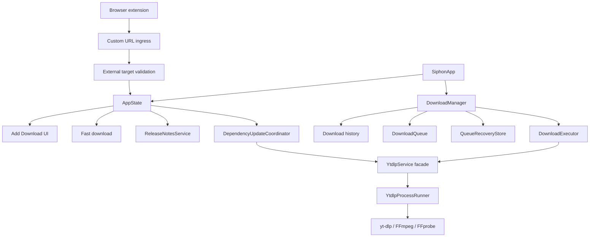

# Siphon Architecture

This document records the runtime ownership boundaries and lifecycle guarantees that are easy to break accidentally in a downloader. It is intentionally narrower than a full code tour.

## Runtime ownership



### Application state

`AppState` owns application-level presentation state and coordination for release notes and dependency updates. Views and app commands observe that state directly.

`DownloadManager` owns download history, queue admission, durable queue recovery, download lifecycle, and the executor. It does not own release-note or dependency-update presentation state.

### Execution ownership

`DownloadExecutor` is the only writer of active task and process-controller ownership. `DownloadManager` exposes read-only execution state and counts rather than task handles.

Stopping or pausing a download requests cancellation. It does not mean the underlying task or process has finished. Executor ownership remains active until `executeDownload` unwinds and its cleanup runs.

The normal cleanup path releases the queue slot, removes task/controller ownership, releases the reserved output path, cleans owned temporary files when appropriate, and notifies the manager that execution finished.

### Durable queue recovery

`QueueRecoveryStore` persists active jobs (`.queued`, `.fetching`, `.downloading`, `.processing`) atomically whenever download state, queue order, or job membership changes.

- Active job metadata (URLs, titles, options, progress, scratch directory paths) is encoded and written atomically to `Application Support/Siphon/queue_recovery.json`. Raw cookies, raw user agents, and arbitrary extra arguments are redacted; the validated non-secret browser-source identifier is retained so protected-site recovery does not silently switch browser profiles.
- Scratch paths are accepted only when they point to Siphon-owned `siphon_scratch_*` directories directly under the process temporary directory. Cleanup refuses any unowned path.
- Paused-job history stores the validated scratch path and non-secret browser-source identifier so pause → quit → reopen → resume can continue partial work against the same browser profile across a clean restart. Raw cookies and raw user agents remain ephemeral.
- Terminal shutdown (`DownloadManager.shutdown()`) records `isCleanShutdown = true`, preventing false-positive recovery prompts across clean application exits.
- If the application process terminates abruptly (crash, SIGKILL, power loss), the uncompleted snapshot remains marked as interrupted. On subsequent launch, `DownloadManager.initialize(...)` detects the interrupted jobs and prompts the user in `ContentView` to restore them back to `.queued` state (preserving per-job scratch directories) or discard them cleanly.

### Recovery and partial-job warnings

Recovered jobs whose advanced arguments were removed are held paused until the user re-enters them or explicitly continues without them. A non-secret review marker survives both recovery and history persistence; argument values remain ephemeral. Recovery write failures appear as a non-blocking warning with a retry action and clear after a successful write. Held restored jobs are committed to history before the interrupted snapshot is replaced.

Partially failed playlists retain their completed output paths but enter Failed with a retry action. Playlist retries skip existing files rather than overwriting completed entries, unless the user explicitly chose overwrite. Partial-failure markers survive history restoration, including migration of older completed-with-error records.

Filename collisions are action-required jobs: they appear in Recent (not Queue or its count) until the user chooses overwrite, a new name, or removal, and history trimming never evicts them. They are never admitted for execution until the user chooses.

### Dependency update exclusion

yt-dlp replacement is serialized against download execution:

- an update request is rejected while `DownloadManager.activeExecutionCount` is non-zero;
- `DownloadManager.processQueue()` does not admit new work while `YtdlpService.isUpdating` is true;
- queued work is reconsidered when the dependency update finishes.

This prevents a binary replacement from racing with executor-owned work while still allowing downloads submitted during an update to remain queued.

### Terminal shutdown

`DownloadManager.shutdown()` is terminal for that manager instance. It disables future queue admission before requesting executor cancellation and clearing queue reservations.

Executor task/controller ownership is still released by executor teardown rather than being eagerly deleted by the manager. The terminal queue gate is what makes reservation clearing safe during application shutdown.

### External URL ingress

Browser extensions enter through `SiphonApp.handleIncomingURL`. The custom URL is accepted only for supported Siphon schemes and download hosts, then the target URL is validated by `ExternalDownloadTargetPolicy` before it reaches download code. For external deep-link downloads, Siphon enforces `enforcePublicNetworkBoundary`: yt-dlp runs through a local loopback forward proxy (`EgressProxyServer` via `--proxy`) that intercepts connection attempts and HTTP redirects, resolving hostnames and blocking access to loopback, private, link-local, and multicast ranges with HTTP 403. Siphon's internal metadata fetches (e.g. Finder icon thumbnails) re-apply the public network policy on every redirect via `PublicRedirectPolicy`. Custom user arguments cannot override this proxy configuration for boundary-enforced downloads. Site-specific resolvers inherit the boundary through the `EgressBoundary.proxyURL` task-local that `YtdlpService.fetchInfo` and `download` bind: their yt-dlp runs, `URLSession` requests and WebKit sessions go through the same proxy. The proxy forwards one plain-HTTP request per upstream connection (`Connection: close`), because clients reuse a proxy connection across hosts.

The proxy rejects bare carriage returns and Unicode header separators, resolves each target once, validates every returned numeric address, and connects to that validated snapshot. Custom yt-dlp executables inherit the boundary by their resolved path even when renamed. Thumbnail fetches also use the public-network proxy, including view tasks outside a download's task-local scope; Finder icons reuse the thumbnail already downloaded by the service. Proxy shutdown retires its cached URLSession, and the route cache has a fixed size limit.

Fast-download deep links hand their sanitized browser identifier and user agent straight to the job; only the Add Download sheet path stores deep-link state in `AppState`, and its external-target marker is cleared when the sheet closes, not when credentials are consumed.

Raw cookies are never accepted through the custom URL. Browser source identifiers and user agents are sanitized, and browser-session state is scoped to the validated target origin (scheme, hostname, and effective port). Playlist expansion across known HTTPS YouTube aliases preserves browser identity, while raw cookies remain restricted to the original exact origin; mixed or unrelated origins receive no session. Chrome, Firefox, and Safari handoff cleanup stores per-tab deadlines in session storage and uses alarms, so service-worker suspension does not lose pending helper tabs; tabs navigated to another page are retained.

### App update trust

Releases newer than `UpdateChecker.lastUnsignedRelease` must carry `release-manifest.json` and `release-manifest.json.sig`, signed offline with the Ed25519 key whose public half is pinned in `UpdateManifestVerifier`. Create both with `swift scripts/sign-release-manifest.swift sign <key> <version> <assets>` and upload them with the release assets; a release without them is refused rather than verified by checksum alone.

### App update installation

Update installation captures an immutable release candidate before its first asynchronous fetch. Manifest and checksum verification use only that candidate; update checks and repeated installations are excluded while preparation or installation is active.

The installer copies and verifies a complete replacement beside the installed app, then exchanges the two directory names using `renameatx_np(RENAME_SWAP)`. Both replacement and rollback are single filesystem operations. A process interruption leaves a complete old or new app at the installed path and the other complete bundle at the sibling backup path. Unsupported exchanges fail with the original app intact; there is no delete-and-copy fallback. A rollback failure retains the original backup and reports its path. A successful update retains the running process's old bundle as a hidden backup until restart; the restart alert opens the new app instead of merely dismissing. On startup, when no other app instance is running, cleanup keeps the newest recovery bundle and removes older updater-named sibling bundles with the same bundle identifier. If restart briefly overlaps the two app processes, cleanup waits for the old process's termination notification. Symlinks, unrelated bundles, and the running bundle are excluded, and cleanup is serialized with bundle replacement. Abrupt interruptions may also leave a hidden backup for recovery; this does not promise storage durability after a hardware or filesystem failure.

## YtdlpService boundary

`YtdlpService` remains the public facade for extraction, site-specific handling, dependency paths, and download orchestration. Splitting its site/runtime responsibilities is deliberately postponed; callers should continue to depend on the facade rather than reaching into implementation details.

## Validation

The canonical macOS test command is:

```bash
xcodebuild test \
  -project Siphon.xcodeproj \
  -scheme Siphon \
  -destination 'platform=macOS' \
  -configuration Debug \
  MACOSX_DEPLOYMENT_TARGET=15.0 \
  CODE_SIGN_IDENTITY="" \
  CODE_SIGNING_REQUIRED=NO \
  CODE_SIGNING_ALLOWED=NO
```
